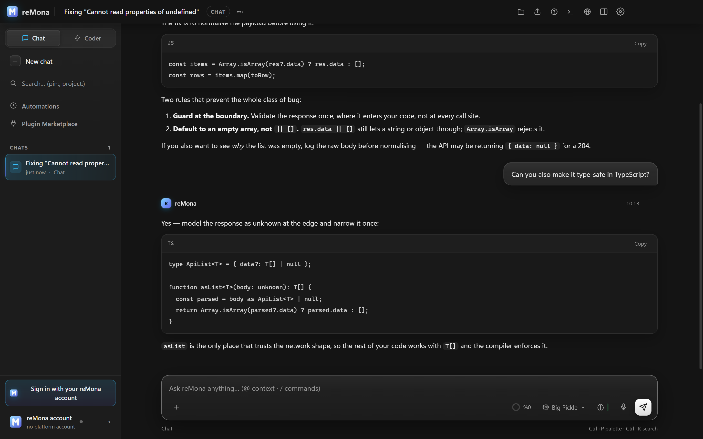
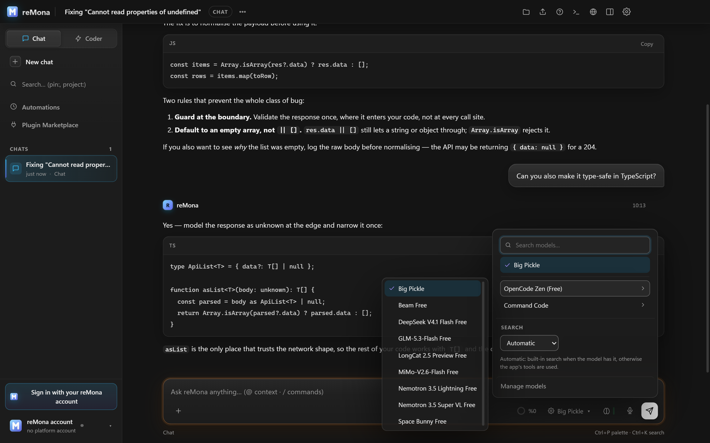
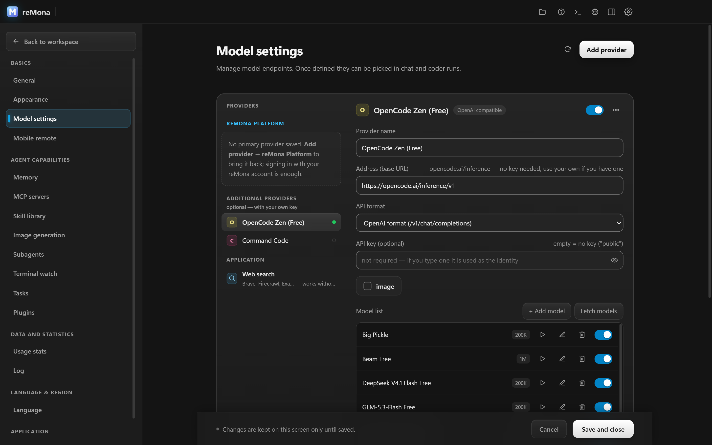
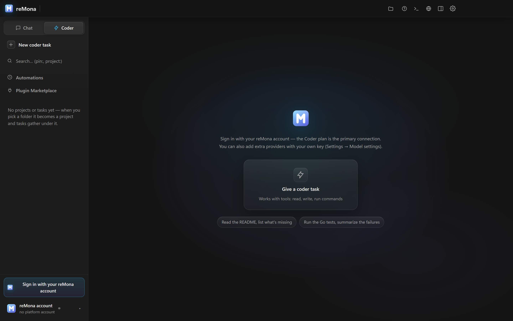
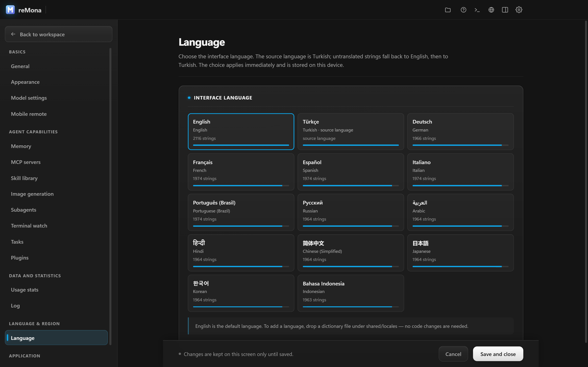

# reMona Desktop

**An agent IDE for Windows that works with free models — no API key required.**

reMona is a desktop **agent IDE**: you add a provider, chat with any model, and run an
autonomous **coder agent** in the same window. The agent reads and writes files, runs
commands in an embedded terminal, opens pages in its own browser, spawns sub-agents, and
hands the result to a Git panel for review and commit.

It is **provider-agnostic** — OpenAI, Anthropic (Claude), Google Gemini, NVIDIA NIM,
OpenRouter, Groq, DeepSeek, Moonshot (Kimi), xAI (Grok), Mistral, Together, Cerebras,
Fireworks, local Ollama, any OpenAI-compatible endpoint — and it **ships with free models
that need no account and no key**.



---

## Free models, no API key

**OpenCode Zen (Free)** is built into the provider catalog and works keyless: the app sends
requests with the fixed `public` identity, exactly as the free tier expects. Pick a model
and start chatting — nothing to sign up for.

| Model | Context | Notes |
| --- | --- | --- |
| **Big Pickle** | 200K | general-purpose default |
| **Beam Free** | 1M | long context |
| **DeepSeek V4.1 Flash Free** | 200K | fast reasoning |
| **GLM-5.3-Flash Free** | 200K | fast, strong at code |
| **LongCat 2.5 Preview Free** | 1M | long context |
| **MiMo-V2.6-Flash Free** | 200K | fast |
| **Nemotron 3.5 Lightning Free** | 262K | low latency |
| **Nemotron 3.5 Super VL Free** | 1M | long context |
| **Space Bunny Free** | 1M | long context |



**Command Code** adds four more free models (`Beam 1.0 Free`, `Cat Jam Free`,
`Glyph Cluster Free`, `Laguna S 2.1 Free`) when you paste its key.

The free tier is IP-rate-limited by the upstream service and its gateway can change — that
is why the app also carries a seeded model list: if the live list cannot be fetched, the
picker still works. Your own key removes the limits.

---

## Screenshots

### Chat — markdown, code blocks, visible reasoning
The composer keeps everything one keystroke away: model, reasoning effort, web search,
permission mode, images, and a run budget.


### Model settings — free models with context windows
Every provider is one card: address, API format, key (optional for Zen), and the model list
with per-model switches.



### Coder — an agent that actually does the work
Pick a folder and give it a task. The run is sandboxed to that workspace, tools are visible
as cards, and permission modes decide whether it asks before editing.



### 13 interface languages, English by default
English · Türkçe · Deutsch · Français · Español · Italiano · Português (Brasil) · Русский ·
العربية (RTL) · हिन्दी · 中文（简体） · 日本語 · 한국어 · Bahasa Indonesia



---

## What it does

| Area | What you get |
| --- | --- |
| **Chat** | Streaming answers, markdown with syntax-highlighted code, Mermaid diagrams, reasoning display, image attachments, retry and edit |
| **Coder agent** | read / write / edit / glob / grep / run-command tools, workspace sandbox, plan-then-apply, three permission modes, run budget in USD |
| **Built-in browser** | The agent browses and screenshots pages itself; you can take over the same tab |
| **Terminal** | Integrated shell with tracking, so the agent sees what a command actually did |
| **Sub-agents** | Parallel workers with their own context, cards in the transcript |
| **Git** | Diff review, commit, and log without leaving the window |
| **Extensibility** | MCP servers, a skills library, plugins, scheduled tasks (Automations) |
| **Providers** | 16 presets plus any OpenAI-compatible or Anthropic-protocol endpoint |
| **Interface** | 13 languages, RTL support, dark/light themes, three layout modes |
| **Maintenance** | Built-in updater with SHA-256 verification, portable data folder, offline-first |

---

## Download and install

**Latest installer:** [remona.net/download/latest](https://remona.net/download/latest) ·
**All versions:** [Releases](../../releases/latest)

| File | Size | What it is |
| --- | --- | --- |
| `reMona-Setup-<version>.exe` | ~134 MB | Windows x64 installer (NSIS) |
| `reMona-Setup-<version>.exe.blockmap` | ~0.2 MB | delta map for auto-update |

The installer is **unsigned**, so Windows SmartScreen shows "Unknown publisher":
choose **More info → Run anyway**. Verify the download instead:

```cmd
certutil -hashfile "reMona-Setup-0.9.15.exe" SHA256
```

SHA-256 for **0.9.15**:
`f6e4053ff3396c6cd9392426921f65aa580f3d41422bc2695f4f19c252553cd0`

Silent install: `reMona-Setup-0.9.15.exe /S`. Uninstalling does **not** delete your chats or
keys; they live in the app data folder.

### Requirements

| | |
| --- | --- |
| OS | Windows 10 or Windows 11 |
| Architecture | x64 (no ARM64 build yet) |
| Disk | ~134 MB installer, ~500 MB installed |
| Internet | Needed for hosted models only (local Ollama works offline) |

---

## First run in 30 seconds

1. **Settings → Model settings** opens on first launch.
2. Pick **OpenCode Zen (Free)** — no key needed — or paste a key for any other provider.
3. Choose a model in the composer's model menu.
4. For coder work, pick a folder; the agent is sandboxed to it.

---

## FAQ

**Is it really free?** The app is free to use and the OpenCode Zen free tier costs nothing
and needs no account. Heavy use is limited by the upstream per-IP quota; your own provider
key removes that limit.

**Do I need a reMona account?** No. You can run everything with your own provider or the
free keyless tier. A reMona account only adds the managed platform plan and usage window.

**Is the source code available?** This repository hosts the published installers and
release notes. The source is not public.

**Does it send my code anywhere?** Requests go to the provider you configured, from your
machine. Nothing is routed through reMona unless you use the reMona Platform provider.

**Can I use it offline?** With a local model (Ollama or any local OpenAI-compatible server)
the whole loop — chat, coder, terminal, Git — runs on your machine.

---

## Search terms

AI agent IDE · autonomous coding agent · desktop AI client · OpenAI-compatible client ·
free LLM models · keyless free tier · OpenCode Zen · Claude / GPT / Gemini / DeepSeek /
Kimi / Grok front-end · MCP client · multi-provider chat · Windows AI app · local LLM GUI ·
ChatGPT desktop alternative · Cursor / Windsurf alternative for Windows

## Links

- Website and downloads — [remona.net](https://remona.net)
- Latest installer — [remona.net/download/latest](https://remona.net/download/latest)
- Update manifest (JSON) — [remona.net/api/desktop/latest](https://remona.net/api/desktop/latest)
